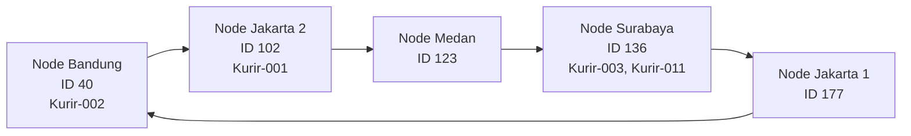

# Tugas 6 (Pekan 6) — Penamaan & Resolusi Lokasi

**Materi terkait:** Flat Naming, Structured Naming (DNS), Distributed Hash Table (DHT)/Chord.

## Studi Kasus

Pelanggan FoodGo kesulitan menemukan alamat IP server kurir yang **dinamis** (kurir berpindah lokasi/jaringan, IP-nya sering berubah). FoodGo butuh cara memetakan **ID Kurir** (identitas tetap) ke **alamat IP terkininya** tanpa server pusat tunggal yang jadi bottleneck/single point of failure.

## Tugas Kelompok

Implementasikan **simulasi Chord DHT** sederhana (single-process, tidak perlu jaringan sungguhan — cukup simulasi struktur data & algoritma di satu program Python) yang memetakan ID Kurir ke alamat IP mereka.

Konsep yang harus terlihat jalan dalam simulasi kalian:
1. **Consistent hashing**: ID Kurir dan ID Node di-hash ke ruang angka yang sama (mis. 0–255 untuk kesederhanaan, `m=8` bit).
2. **Ring topology**: node-node diurutkan melingkar berdasarkan hasil hash-nya.
3. **Lookup**: fungsi `lookup(kurir_id)` yang menemukan node mana yang bertanggung jawab menyimpan mapping ID Kurir tersebut → alamat IP-nya (aturan Chord: node dengan ID hash **terkecil yang lebih besar atau sama dengan** hash key, disebut *successor*).
4. **Perubahan topologi**: simulasikan minimal satu node baru bergabung (`join`) atau satu node keluar (`leave`), tunjukkan bagaimana mapping berpindah tanggung jawab ke node lain.

Skeleton disediakan di `src/chord_simulation.py` dengan fungsi hashing dan struktur ring sudah ada — bagian `lookup()`, `join()`, dan `leave()` sengaja dikosongkan.

### Cara Menjalankan

```bash
python3 src/chord_simulation.py
```

## Tugas Analisis (`README.md`)

1. Jelaskan **kenapa DHT/Chord** lebih cocok untuk kasus ini dibanding **flat naming sederhana** (mis. tabel pusat ID→IP) atau **DNS konvensional** — kaitkan dengan sifat "IP kurir sering berubah" dan kebutuhan tanpa titik gagal tunggal.
2. Gambarkan (boleh pakai Mermaid, lihat Tugas 2) ring topology dari simulasi kalian, tandai node mana yang bertanggung jawab atas ID Kurir mana.
3. Jelaskan apa yang terjadi pada mapping saat sebuah node **keluar** dari ring (siapa yang mengambil alih tanggung jawabnya) — dukung dengan output program.

JAWAB:
1. DHT/Chord cocok untuk FoodGo karena ID kurir tetap, sedangkan alamat IP kurir dapat berubah ketika kurir berpindah lokasi atau jaringan. Dengan Chord, sistem mencari alamat IP berdasarkan ID kurir melalui proses hashing dan aturan successor. Ketika IP kurir berubah, pemetaan ID kurir ke IP dapat diperbarui tanpa mengubah identitas kurir.
Berbeda dengan flat naming berupa tabel pusat ID→IP, Chord membagi tanggung jawab penyimpanan ke beberapa node. Tabel pusat dapat menjadi bottleneck dan single point of failure jika server pusat bermasalah. DNS juga dapat memetakan nama ke alamat IP, tetapi perubahan alamat dapat terdampak cache dan waktu propagasi. Chord mendistribusikan pemetaan serta menentukan node penanggung jawab berdasarkan ring. Dengan demikian, Chord lebih sesuai untuk simulasi kebutuhan FoodGo yang menginginkan pemetaan terdistribusi tanpa satu server pusat.

2. ### Ring Topology Chord DHT

Diagram berikut menunjukkan ring setelah node Medan bergabung dan sebelum node Surabaya keluar. Setiap node diberi label ID hash dan kurir yang menjadi tanggung jawabnya.



3. Pada output program, node Surabaya dengan ID 136 keluar dari ring. Sebelum keluar, node tersebut bertanggung jawab atas mapping kurir-003 dan kurir-011. Setelah node 136 dihapus, node successor berikutnya untuk kedua mapping tersebut adalah node Jakarta 1 dengan ID 177.

Output program menunjukkan:
Node 'node-surabaya-1' (ID=136) keluar dari ring
Mapping kurir-003 (192.168.1.12) pindah ke node ID=177
Mapping kurir-011 (192.168.1.20) pindah ke node ID=17

## Struktur Submission

```
tugas-06-penamaan-dht/
├── README.md      # Analisis + diagram ring
├── JURNAL.md
├── src/
│   └── chord_simulation.py
└── bukti/          # Output program (screenshot/log) untuk skenario join & leave
```

## Rubrik Penilaian (Tugas 6)

| Komponen | Bobot | Kriteria |
|---|---|---|
| Implementasi lookup/join/leave benar | 35% | Consistent hashing & successor lookup sesuai aturan Chord |
| Bukti perubahan topologi (join/leave) | 25% | Output menunjukkan mapping berpindah dengan benar |
| Analisis kenapa DHT vs flat naming/DNS | 25% | Argumen spesifik ke kasus IP kurir dinamis, bukan definisi umum |
| Proses & kontribusi kelompok | 15% | `JURNAL.md`, commit history |

## Batasan Penggunaan AI (Level 2)

Kebijakan **Level 2 (AI Assisted Idea Generation & Structuring)** berlaku — lihat [`../RUBRIK-UMUM.md`](../RUBRIK-UMUM.md). Boleh bertanya konsep umum consistent hashing/Chord ke AI; **tidak boleh** meminta AI menuliskan isi `# TODO` di `src/chord_simulation.py` (`find_successor`, `join`, `leave`, dst). Catat pemakaian AI di "Log Penggunaan AI" pada `JURNAL.md`.

- `README.md` wajib menelusuri manual (langkah demi langkah) bagaimana `lookup()` menemukan successor untuk salah satu ID Kurir contoh yang dipakai di `chord_simulation.py` — bukan cuma menempelkan output program.
